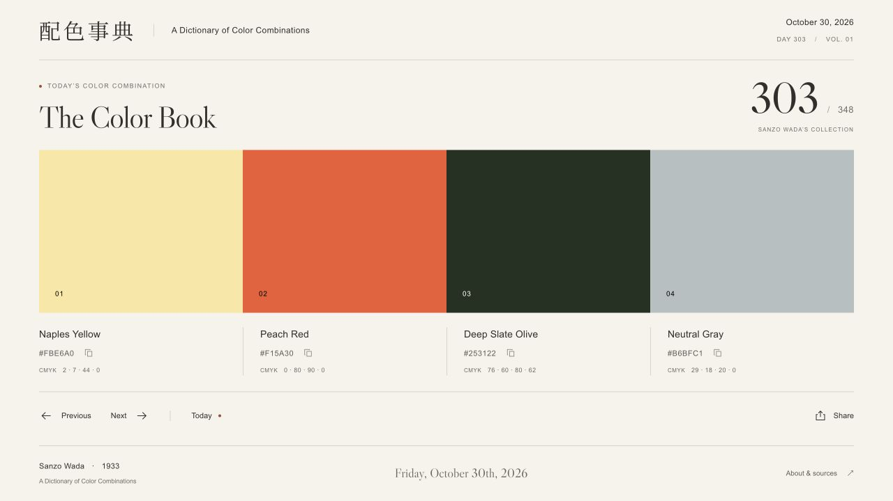

# The Color Book

**One day. One historical Japanese color combination.**

A quiet daily edition of Sanzo Wada’s *A Dictionary of Color Combinations*. Each local calendar day opens one of 348 original numbered palettes, presented with generous whitespace, warm ivory paper, and restrained typography.



*Combination 303: Naples Yellow, Peach Red, Deep Slate Olive, and Neutral Gray. Captured October 30, 2026.*

## Features

- All **348 combinations and 159 colors**, with original numbering, English names, HEX values, and CMYK values preserved from the source dataset.
- Today’s palette follows the visitor’s local calendar and changes at local midnight.
- Previous, Next, and arrow-key navigation; Today returns to the current edition. The header and written footer dates follow the displayed palette.
- Click a swatch or HEX value to copy it. Share copies a permanent numbered URL such as `/277`.
- Responsive layouts for two-, three-, and four-color palettes, accessible controls, and self-hosted fonts.
- Pre-rendered pages and individual Open Graph previews, ready to serve as static files from your own web server.

Built with **Next.js, TypeScript, React, and Tailwind CSS**. No accounts, analytics, cookies, runtime data services, or UI libraries.

## Quick start

Requires **Node.js 22.13 or newer** and npm. On macOS, these commands run directly in Terminal; no Docker, server account, or DNS configuration is required.

```sh
git clone https://github.com/pgerhardt/colorbook.git
cd colorbook
npm ci
npm run dev
```

If you use nvm, run `nvm install` and `nvm use` after cloning and before installing dependencies; `.nvmrc` selects Node 22. No environment variables are required.

Open http://127.0.0.1:3000. Edits update automatically. On later runs, just use `npm run dev`. Stop the server with **Control-C** in its terminal.

## Build and preview

To build and preview the complete static website locally:

```sh
npm run preview
```

This builds all 348 numbered pages and their share images into `out/`, then serves them at the same local address. Use `npm start` to serve an existing build without rebuilding. Direct links such as http://127.0.0.1:3000/277 work in both modes, including after a refresh. Copy and Share work on the local address; copied links are local to your computer.

Run only one mode on port 3000 at a time. If another app uses that port, choose a different one:

```sh
PORT=3001 npm run dev
# or, for the built site:
PORT=3001 npm run preview
```

Both servers bind to `127.0.0.1` by default. The site runs entirely locally once dependencies are installed, with bundled data and fonts. The optional nginx setup below is for publishing it later on your web server.

## The collection

The original, unmodified `colors.json` and MIT license from [mattdesl/dictionary-of-colour-combinations](https://github.com/mattdesl/dictionary-of-colour-combinations) are in `data/source/`. The data was initially compiled by [Dain M. Blodorn Kim](https://github.com/dblodorn/sanzo-wada) and corrected and converted to digital color values by Matt DesLauriers.

- Pinned source commit: `c142bd0bc8049ea48db4da5eb397981f047e8ef4`.
- SHA-256: `555f11c32eb8133078fd470dd7d5320533aaa8b636f12fa06a8dd3d0ee2703b4`.
- 159 colors; 120 pairs, 120 trios, and 108 quartets.
- `scripts/import-palettes.mjs` constructs each palette from the explicit **original combination numbers** in each source color’s `combinations` field. Colors remain in upstream order. No sorting assigns or changes combination numbers.
- English names, HEX, CMYK, RGB, LAB, and swatch references are preserved verbatim in `data/palettes.json`.
- The upstream dataset has no Japanese color names. `japaneseName` and `japaneseNameSource` deliberately remain null; the UI supports a sourced name but does not invent translations.
- One source value, Dull Violet Black’s magenta value, is **106**. It is intentionally preserved, not clamped or recomputed.

```sh
npm run data:import  # Validate and regenerate from the local snapshot, offline
npm run data:fetch   # Explicitly restore the pinned snapshot from GitHub
```

The import script fails for a changed checksum, missing numbers, bad memberships, or unexpected palette/color counts. All palette data and fonts are local at runtime; ordinary builds require no font or dataset downloads. Dependency installation needs the npm registry.

The historical source is Wada’s *Haishoku Sōkan* (配色総鑑), published in 1933–1934. Seigensha’s 2010 edition, [A Dictionary of Color Combinations](https://en.seigensha.com/books/978-4-86152-247-5/), brings these studies together in a compact reference. This project is an independent digital interpretation; screen colors are the dataset’s digital interpretations of printed swatches. The interface is inspired by Japanese print design and [sanzocolors.com](https://sanzocolors.com/); its palette data is imported exclusively from the specified repository.

## Daily behavior and URLs

- `/` always opens today’s combination in the visitor’s **local calendar**.
- January 1 is day 1. The day ordinal is calculated using local year/month/day with `Date.UTC` arithmetic so DST cannot shift the result.
- `((dayOfYear - 1) % 348) + 1` maps days 349–365/366 to palettes 1–17/18.
- The homepage server-renders a stable, quiet placeholder, then `useSyncExternalStore` resolves the local date immediately on hydration. It never displays a guessed UTC/server-date palette or suppresses a hydration mismatch.
- A timer targets the next **local** midnight, with a one-minute cap to pick up clock/timezone changes. Focus, visibility, and `pageshow` refresh the date after a sleeping/background tab returns.
- `/1` through `/348` are pre-rendered permanent pages. They retain their combination through refreshes, timezones, and midnight. The header and written footer date follow the displayed combination in the visitor’s current year. For combinations repeated in late December, the occurrence closest to today is used.
- Previous/Next and left/right keys navigate numbered URLs and wrap between 1 and 348. Browser Back/Forward works normally. Today returns to `/`.
- Swatches and HEX labels copy the uppercase source HEX. Share copies the current origin plus the numbered route, so production shares use `https://colorbook.pmg.dev/277` and previews stay on their preview origin.
- Clipboard access requires HTTPS or localhost. Failures produce an accessible message. Success is announced through a live region and shown with a small checkmark or “Link copied” label.

The source colophon is a native modal dialog with keyboard focus containment, Escape dismissal, and focus restoration. Swatch numbers always use the higher-contrast black/white ink. Links, controls, and palettes have descriptive accessible names.

## Metadata and fonts

Every numbered page has its own title, description, canonical URL, and a 1200×630 PNG Open Graph/Twitter preview using its actual colors and names. Next.js `ImageResponse` generates all 349 PNG files from local data during the build; no image server or runtime generation is needed. The homepage preview is an evergreen cover, not a claimed visitor-specific daily image. The sitemap includes the homepage and every combination; invalid numbers return 404.

Libre Caslon Display and a small Noto Serif JP masthead subset are self-hosted in `public/fonts/`, with their SIL Open Font License notices. English metadata uses the system sans-serif stack. There are no external font requests.

## Verify

```sh
npm test             # Source fidelity, every palette, date and DST boundaries
npm run typecheck    # Generated route types + strict TypeScript
npm run build        # Static export to out/, including every share image
npm start            # Preview out/ in another terminal before checking routes
npm run test:routes  # All 348 URLs, SSR, 404s, canonical/OG tags, PNGs, sitemap
```

`TEST_BASE_URL` can point the route checks at a different local port or deployment. Calendar tests cover every day of several normal, leap, and century years across six timezones. Browser QA should include `/1`, `/121`, `/277`, `/348`, Today, copy/share, arrows, Back/Forward, the source dialog, and 320/390/768/desktop viewport widths.

## Self-hosting with nginx

The application is a **static export for your own nginx web server**. There is no hosted-platform dependency, Node service, application port, database, or runtime API to configure.

```sh
npm ci
npm run build
```

Deploy the **entire contents of `out/`** to a dedicated Color Book document root on the server. Preserve its directory structure, including `_next/`, `.txt` navigation payloads, and the numbered image directories. Keep older hashed assets during an update if visitors may still have the previous version open; publishing versioned directories with a document-root symlink is an alternative.

The project’s canonical hostname is configured as `colorbook.pmg.dev`; substitute your own hostname when deploying elsewhere. For the nginx virtual host:

1. Set `root` to that dedicated document root and include nginx’s usual MIME types.
2. Include the location rules in [`deploy/nginx.locations.conf`](deploy/nginx.locations.conf), or put their contents inside this virtual host’s `server` block. They map `/277` to `277.html`, serve the extensionless Open Graph files as `image/png`, and keep unknown routes as real 404s. Do not add a catch-all rewrite to `index.html`.
3. Point your hostname at the server and configure HTTPS. `.dev` domains require HTTPS in browsers; HTTPS also enables clipboard copying. Keep TLS configuration with your existing server/certificate manager.
4. Validate the full nginx configuration with `nginx -t`, then reload nginx using the server’s existing service manager.
5. Run `TEST_BASE_URL=https://colorbook.pmg.dev npm run test:routes` to check the deployed hostname.

`src/lib/site.ts` contains the canonical production URL. The homepage still changes at each visitor’s local midnight without a daily rebuild. To update code or data, rebuild and publish a new `out/`.
